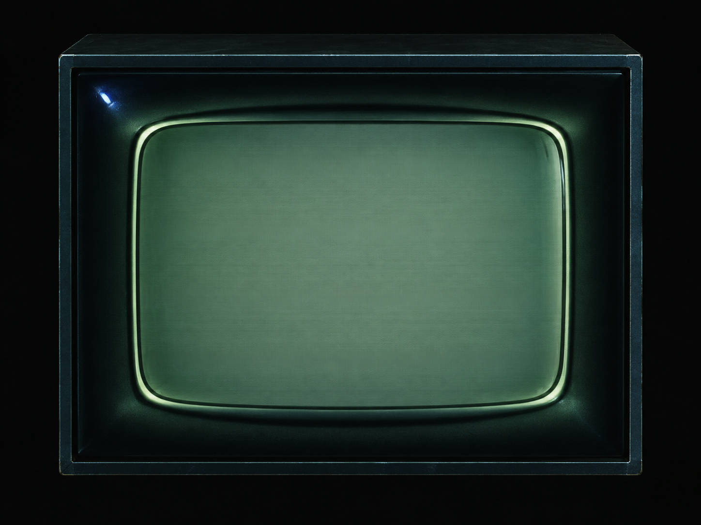

# TV frame design preview

Visual design stage, requested 2026-10-08. Match the supplied monitor-wall reference before adding camera input.

- Rectangular charcoal cabinet with thin blue-green outer metal edges.
- A recessed 4:3 glass display with gently bowed sides and rounded corners.
- Deep sculpted black bezel and a narrow pale green double rim.
- Muted gray-green phosphor, fine grille/scanlines, soft corner shading, restrained blue-white reflections.
- Empty screen area reserved for terminal content or a future live camera feed.

Camera integration is a later implementation step. The design preview does not access a camera, record video, or change the installed application. When implemented, camera selection and start/stop should be explicit; live video should pass through the same CRT treatment as terminal content.

## Native preview

The updated source includes **View → TV design preview…**. To open only the design without starting terminal sessions or loading normal settings, run the rebuilt executable with `--tv-preview`. The preview now overlays a real QMLTermWidget terminal on the glass. It starts a live code-rain demo; press lowercase **q** to leave the demo and use the shell. The cabinet scales with the window. The original app stays intact; camera video is not implemented yet.
